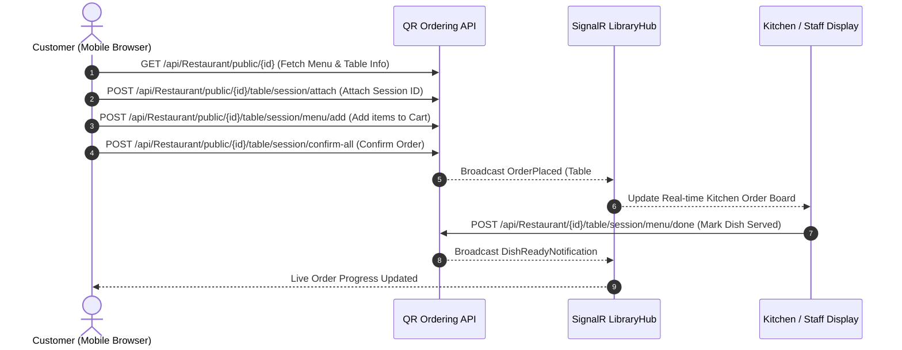
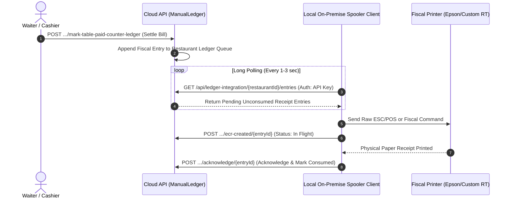

# QR Ordering System API — Technical Reference & Developer Guide

> **Interactive Documentation UI:** [`https://localhost:7113/scalar/v1`](https://localhost:7113/scalar/v1)  
> **OpenAPI 3.1.1 Spec:** [`https://localhost:7113/openapi/v1.json`](https://localhost:7113/openapi/v1.json)  
> **Target Server:** `https://localhost:7113/`  
> **Architecture Style:** Event Sourcing & CQRS (Sharpino Domain), RESTful Web API, SignalR WebSockets  

---

## Table of Contents
1. [System Architecture & Core Concepts](#1-system-architecture--core-concepts)
2. [Authentication & Authorization](#2-authentication--authorization)
3. [Rate Limiting Policies](#3-rate-limiting-policies)
4. [API Endpoints Reference by Module](#4-api-endpoints-reference-by-module)
   - [4.1 Authentication](#41-authentication)
   - [4.2 Restaurant & Table Ordering](#42-restaurant--table-ordering)
   - [4.3 Menu Catalogue & Item Management](#43-menu-catalogue--item-management)
   - [4.4 Stock & Inventory Management](#44-stock--inventory-management)
   - [4.5 Manual Ledger & Fiscal ECR Spooler](#45-manual-ledger--fiscal-ecr-spooler)
   - [4.6 Stripe Payments & Connect](#46-stripe-payments--connect)
   - [4.7 AI Menu Digitization & OCR](#47-ai-menu-digitization--ocr)
   - [4.8 HowTo Semantic Assistant](#48-howto-semantic-assistant)
   - [4.9 Voting & Dish Ratings](#49-voting--dish-ratings)
   - [4.10 Reporting & Analytics](#410-reporting--analytics)
   - [4.11 Document Storage](#411-document-storage)
   - [4.12 Platform Maintenance & Diagnostics](#412-platform-maintenance--diagnostics)
5. [Key Domain Models & Data Schemas](#5-key-domain-models--data-schemas)
6. [Integration Workflows & Sequence Diagrams](#6-integration-workflows--sequence-diagrams)

---

## 1. System Architecture & Core Concepts

The QR Ordering System is an event-sourced platform designed for contactless dining, kitchen order fulfillment, real-time table management, inventory synchronization, and fiscal compliance:
- **Event-Sourced Aggregates:** Core entities (`Restaurant`, `StockInventory`, `Catalogue`, `ManualLedger`) follow event-sourcing principles. State changes emit immutable domain events into an underlying event store with automated periodic snapshotting.
- **Diner Session Decoupling:** Customers scan dynamic table QR codes to initiate isolated diner browser sessions. Multiple diners at the same table can order concurrently and settle individually or split bills into payment groups.
- **Hardware Fiscal Spooler Integration:** Designed for European/Italian compliance (Registratore Telematico / RT, Epson, and Custom ECRs) with long-polling/webhook spooler queues, idempotency, and status acknowledgments.
- **AI & Vision Pipeline:** Multi-modal LLM and vision OCR pipelines for digitizing physical paper menus directly into menu structures, predicting recipe ingredient consumption, and extracting invoice / delivery document (DDT) metadata.

---

## 2. Authentication & Authorization

The API provides three authentication mechanisms:
1. **JWT Bearer Token:** Used by mobile apps, frontend clients, and external API integrations. Send via `Authorization: Bearer <token>` header.
   - Obtain via `POST /api/Auth/token` using email/password, or `POST /api/Auth/session-token` using existing web session cookies.
2. **Dedicated Fiscal API Key:** Used by on-premise hardware fiscal printer spoolers. Supported via `X-API-Key: <key>` header or `Authorization: Bearer <key>` on `/api/ledger-integration/*` endpoints.
3. **Public / Anonymous Diner Access:** Endpoints prefixed with `/api/Restaurant/public/*` allow unauthenticated diners at physical tables to view menus, register session IDs, add items to cart, and checkout.

---

## 3. Rate Limiting Policies

| Policy Name | Target Endpoints | Guest / Anonymous | Authenticated Patron | Librarian / Admin |
| :--- | :--- | :--- | :--- | :--- |
| **AiServicesPolicy** | `/api/ModelAi/*`, `/api/HowTo/*` | 5 req / 1 min (IP-based) | 20 req / 1 min (UserId) | 100 req / 1 min (Admin) |
| **CatalogIngestionPolicy** | Catalog & menu bulk sync | 10 req / 1 min (IP) | 30 req / 1 min (UserId) | 30 req / 1 min (API Key) |
| **Global AI Ceiling** | All AI routes | 60 req / 1 min global ceiling | | |

---

## 4. API Endpoints Reference by Module

### 4.1 Authentication (4 Endpoints)

| Method | Endpoint | Description | Auth / Body |
| :--- | :--- | :--- | :--- |
| **POST** | `/api/Auth/token` | Authenticates a user with email and password and returns a JWT Bearer access token. | Body: `TokenRequest, text/json: TokenRequest, application/*+json: TokenRequest` |
| **GET** | `/api/Auth/session-token` | Generates a JWT Bearer token using the caller's active ASP.NET Core Identity authentication cookie or session. | None |
| **POST** | `/api/Auth/session-token` | Generates a JWT Bearer token using the caller's active ASP.NET Core Identity authentication cookie or session. | None |
| **GET** | `/api/Auth/me` | Retrieves identity and authorization context for the currently logged-in user. | None |

### 4.2 Restaurant & Table Ordering (84 Endpoints)

| Method | Endpoint | Description | Auth / Body |
| :--- | :--- | :--- | :--- |
| **POST** | `/api/Restaurant/create` | Creates a new restaurant aggregate associated with the authenticated user. | Body: `CreateRestaurantRequest, text/json: CreateRestaurantRequest, application/*+json: CreateRestaurantRequest` |
| **GET** | `/api/Restaurant/my-restaurants` | Retrieves all restaurant aggregates owned by or accessible to the authenticated user. | None |
| **GET** | `/api/Restaurant/{id}` | Retrieves detailed information for a specific restaurant by its identifier. | None |
| **GET** | `/api/Restaurant/{id}/history` | Retrieves the raw event store history for the specified restaurant aggregate. | None |
| **GET** | `/api/Restaurant/public/{id}` | Retrieves public details of a restaurant for unauthenticated diners (menu, basic info). | None |
| **POST** | `/api/Restaurant/{id}/table/{tableNum}/orders/reset` | Resets active orders on a specific table (e.g. at the conclusion of customer dining or table clearing). | None |
| **POST** | `/api/Restaurant/{id}/table/add` | Adds a new dining table to the restaurant floor plan. | Body: `Table, text/json: Table, application/*+json: Table` |
| **POST** | `/api/Restaurant/{id}/table/remove-top` | Removes the highest-indexed table from the restaurant's table list. | None |
| **POST** | `/api/Restaurant/{id}/table/{index}/regenerate` | Regenerates the unique cryptographic identifier for a table (invalidating old QR codes). | None |
| **POST** | `/api/Restaurant/{id}/table/{tableNum}/max-sessions/{maxSessions}` | Updates the maximum number of concurrent customer ordering sessions permitted at a table. | None |
| **POST** | `/api/Restaurant/{id}/table/{tableNum}/skip-seat-fee/{skip}` | Toggles whether the cover / seating charge should be waived for a specific table. | None |
| **POST** | `/api/Restaurant/{id}/table/{tableNum}/session/{sessionId}/mark-seat-fee-paid` | Marks the seating / cover fee as paid for a specific diner session. | None |
| **GET** | `/api/Restaurant/public/{id}/table/{tableNum}/session/{sessionId}/seating-fee` | Calculates the effective seating or cover fee applicable to a diner session. | None |
| **POST** | `/api/Restaurant/public/{id}/table/session/attach` | Attaches an anonymous diner browser/device session to a physical dining table. | Body: `AttachSessionRequest, text/json: AttachSessionRequest, application/*+json: AttachSessionRequest` |
| **POST** | `/api/Restaurant/public/{id}/table/session/detach` | Detaches an active diner session from a table (e.g. customer leaving or closing browser). | Body: `DetachSessionRequest, text/json: DetachSessionRequest, application/*+json: DetachSessionRequest` |
| **POST** | `/api/Restaurant/public/{id}/table/session/fiscal-metadata/set` | Associates fiscal tax metadata (Italian Codice Fiscale or Codice Lotteria) with a diner session for receipt issuance. | Body: `SetFiscalMetadataRequest, text/json: SetFiscalMetadataRequest, application/*+json: SetFiscalMetadataRequest` |
| **POST** | `/api/Restaurant/public/{id}/table/session/fiscal-metadata/unset` | Removes any previously set fiscal tax metadata from a diner session. | Body: `UnsetFiscalMetadataRequest, text/json: UnsetFiscalMetadataRequest, application/*+json: UnsetFiscalMetadataRequest` |
| **POST** | `/api/Restaurant/public/{id}/table/session/menu/add` | Adds an item to a diner session's pending order cart. | Body: `SessionMenuItemRequest, text/json: SessionMenuItemRequest, application/*+json: SessionMenuItemRequest` |
| **POST** | `/api/Restaurant/public/{id}/table/session/menu/remove` | Removes an item from a diner session's pending order cart. | Body: `SessionMenuItemRequest, text/json: SessionMenuItemRequest, application/*+json: SessionMenuItemRequest` |
| **POST** | `/api/Restaurant/public/{id}/table/session/menu/confirm-item` | Confirms a single menu item in the session cart, placing the order for preparation. | Body: `SessionMenuItemRequest, text/json: SessionMenuItemRequest, application/*+json: SessionMenuItemRequest` |
| **POST** | `/api/Restaurant/public/{id}/table/session/confirm-all` | Confirms all items in the diner session's pending order cart. | Body: `AttachSessionRequest, text/json: AttachSessionRequest, application/*+json: AttachSessionRequest` |
| **POST** | `/api/Restaurant/public/{id}/table/session/confirm-all-2` | Confirms all items in the diner session's pending order cart using v2 ordering pipeline. | Body: `AttachSessionRequest, text/json: AttachSessionRequest, application/*+json: AttachSessionRequest` |
| **POST** | `/api/Restaurant/public/{id}/table/session/confirm-all-prepayment` | Confirms all items in the session order cart requiring upfront Stripe prepayment. | Body: `ConfirmOrdersWithPrepaymentRequest, text/json: ConfirmOrdersWithPrepaymentRequest, application/*+json: ConfirmOrdersWithPrepaymentRequest` |
| **POST** | `/api/Restaurant/public/{id}/table/session/confirm-all-prepayment-2` | Confirms all items in the session order cart requiring upfront Stripe prepayment (v2 pipeline). | Body: `ConfirmOrdersWithPrepaymentRequest, text/json: ConfirmOrdersWithPrepaymentRequest, application/*+json: ConfirmOrdersWithPrepaymentRequest` |
| **POST** | `/api/Restaurant/public/{id}/table/session/confirm-stripe-payment` | Confirms final Stripe card settlement payment for a diner session (with optional tip). | Body: `ConfirmStripePaymentRequest, text/json: ConfirmStripePaymentRequest, application/*+json: ConfirmStripePaymentRequest` |
| **POST** | `/api/Restaurant/{id}/table/session/menu/done` | Marks an individual ordered item as completed/served by kitchen or bar staff. | Body: `SessionMenuItemRequest, text/json: SessionMenuItemRequest, application/*+json: SessionMenuItemRequest` |
| **POST** | `/api/Restaurant/{id}/table/session/menu/reject` | Rejects an individual ordered item with an optional explanation/reason (e.g. out of ingredients). | Body: `RejectSessionMenuItemRequest, text/json: RejectSessionMenuItemRequest, application/*+json: RejectSessionMenuItemRequest` |
| **POST** | `/api/Restaurant/{id}/table/session/menu/mark-item-paid-counter` | Marks an individual ordered item as paid at the physical cashier counter without adding a ledger entry. | Body: `SessionMenuItemRequest, text/json: SessionMenuItemRequest, application/*+json: SessionMenuItemRequest` |
| **POST** | `/api/Restaurant/{id}/table/session/mark-session-paid-counter` | Marks all ordered items in a diner session as paid at the counter without adding a ledger entry. | Body: `AttachSessionRequest, text/json: AttachSessionRequest, application/*+json: AttachSessionRequest` |
| **POST** | `/api/Restaurant/{id}/table/mark-table-paid-counter` | Marks all ordered items across all sessions at a table as paid at the counter without adding a ledger entry. | Body: `MarkTableOrdersPaidAtCounterRequest, text/json: MarkTableOrdersPaidAtCounterRequest, application/*+json: MarkTableOrdersPaidAtCounterRequest` |
| **POST** | `/api/Restaurant/{id}/table/session/menu/mark-item-paid-counter-ledger` | Marks an individual item as paid at the counter and logs an accounting transaction entry in the restaurant ledger. | Body: `MarkItemPaidAtCounterAddingLedgerEntryRequest, text/json: MarkItemPaidAtCounterAddingLedgerEntryRequest, application/*+json: MarkItemPaidAtCounterAddingLedgerEntryRequest` |
| **POST** | `/api/Restaurant/{id}/table/session/mark-session-paid-counter-ledger` | Marks all items in a diner session as paid at the counter and logs an accounting transaction in the restaurant ledger. | Body: `MarkSessionOrdersPaidAtCounterAddingLedgerEntryRequest, text/json: MarkSessionOrdersPaidAtCounterAddingLedgerEntryRequest, application/*+json: MarkSessionOrdersPaidAtCounterAddingLedgerEntryRequest` |
| **POST** | `/api/Restaurant/{id}/table/mark-table-paid-counter-ledger` | Marks all items across a table as paid at the counter and logs an accounting transaction in the restaurant ledger. | Body: `MarkTableOrdersPaidAtCounterAddingLedgerEntryRequest, text/json: MarkTableOrdersPaidAtCounterAddingLedgerEntryRequest, application/*+json: MarkTableOrdersPaidAtCounterAddingLedgerEntryRequest` |
| **POST** | `/api/Restaurant/{id}/table/session/register-stripe-ledger` | Links an authorized Stripe payment intent to the restaurant ledger for bookkeeping. | Body: `RegisterStripePaymentIntentToLedgerRequest, text/json: RegisterStripePaymentIntentToLedgerRequest, application/*+json: RegisterStripePaymentIntentToLedgerRequest` |
| **POST** | `/api/Restaurant/{id}/settle-pay-at-counter-with-ledger` | Settles selected pay-at-counter order items in a single transaction, recording a ledger entry and applying any discount. | Body: `SettlePayAtCounterItemsAddingLedgerEntryRequest, text/json: SettlePayAtCounterItemsAddingLedgerEntryRequest, application/*+json: SettlePayAtCounterItemsAddingLedgerEntryRequest` |
| **POST** | `/api/Restaurant/{id}/mark-pay-at-counter-no-ledger` | Marks selected order items as settled at counter without recording a ledger accounting entry. | Body: `MarkPayAtCounterItemsWithoutLedgerRequest, text/json: MarkPayAtCounterItemsWithoutLedgerRequest, application/*+json: MarkPayAtCounterItemsWithoutLedgerRequest` |
| **POST** | `/api/Restaurant/{id}/payment-groups` | Creates and publishes a split payment group set (e.g. splitting bill evenly or by items). | Body: `PublishPaymentGroupSetRequest, text/json: PublishPaymentGroupSetRequest, application/*+json: PublishPaymentGroupSetRequest` |
| **GET** | `/api/Restaurant/{id}/payment-groups/{setId}` | Retrieves an existing payment group set by its identifier. | None |
| **GET** | `/api/Restaurant/public/payment-groups/{setId}/group/{groupId}` | Retrieves a single payment group within a group set for unauthenticated customer checkout. | None |
| **POST** | `/api/Restaurant/public/payment-groups/adopt-item` | Reallocates / adopts an unallocated order item into a specific payment group. | Body: `AdoptPaymentGroupItemRequest, text/json: AdoptPaymentGroupItemRequest, application/*+json: AdoptPaymentGroupItemRequest` |
| **POST** | `/api/Restaurant/public/payment-groups/remove-adopted-item` | Removes a previously adopted item from a payment group, returning it to unallocated status. | Body: `RemoveAdoptedPaymentGroupItemRequest, text/json: RemoveAdoptedPaymentGroupItemRequest, application/*+json: RemoveAdoptedPaymentGroupItemRequest` |
| **POST** | `/api/Restaurant/public/payment-groups/settle` | Settles a specific split payment group using Stripe payment intent. | Body: `SettleGroupPaymentRequest, text/json: SettleGroupPaymentRequest, application/*+json: SettleGroupPaymentRequest` |
| **POST** | `/api/Restaurant/{id}/members/add` | Grants staff/member access permissions for this restaurant to another user ID. | Body: `string, text/json: string, application/*+json: string` |
| **POST** | `/api/Restaurant/{id}/members/remove` | Revokes staff/member access permissions for a user from this restaurant. | Body: `string, text/json: string, application/*+json: string` |
| **POST** | `/api/Restaurant/{id}/menu/category/rename` | Renames an existing menu category across the restaurant's catalogue. | Body: `RenameCategoryRequest, text/json: RenameCategoryRequest, application/*+json: RenameCategoryRequest` |
| **POST** | `/api/Restaurant/{id}/admin/transfer` | Transfers primary administrative ownership of the restaurant to another registered user. | Body: `string, text/json: string, application/*+json: string` |
| **POST** | `/api/Restaurant/{id}/cidr` | Configures a CIDR IP subnet mask restriction to restrict table ordering to in-venue Wi-Fi. | Body: `string, text/json: string, application/*+json: string` |
| **POST** | `/api/Restaurant/{id}/cidr/unset` | Removes the CIDR IP subnet restriction, allowing ordering from any network. | None |
| **POST** | `/api/Restaurant/{id}/self-ordering/no` | Disables customer self-ordering venue-wide (view-only digital menu mode). | None |
| **POST** | `/api/Restaurant/{id}/self-ordering/cash-only` | Configures venue-wide self-ordering in cash-only mode (customers order from table and pay at counter). | None |
| **POST** | `/api/Restaurant/{id}/self-ordering/cache-and-stripe` | Configures venue-wide self-ordering allowing both cash (counter) and online Stripe card payments. | None |
| **POST** | `/api/Restaurant/{id}/self-ordering/only-stripe` | Configures venue-wide self-ordering requiring online Stripe card payments exclusively. | None |
| **POST** | `/api/Restaurant/{id}/tables/{tableIndex}/self-ordering/reset` | Resets self-ordering configuration for a specific table back to the venue default. | None |
| **POST** | `/api/Restaurant/{id}/tables/self-ordering/reset-all` | Resets per-table self-ordering configuration overrides across all tables back to venue defaults. | None |
| **POST** | `/api/Restaurant/{id}/tables/{tableIndex}/self-ordering/no` | Disables customer self-ordering specifically on an individual table. | None |
| **POST** | `/api/Restaurant/{id}/tables/{tableIndex}/self-ordering/cash-only` | Configures an individual table to cash-only self-ordering mode. | None |
| **POST** | `/api/Restaurant/{id}/tables/{tableIndex}/self-ordering/cache-and-stripe` | Configures an individual table to permit both cash and Stripe online payments. | None |
| **POST** | `/api/Restaurant/{id}/tables/{tableIndex}/self-ordering/only-stripe` | Restricts an individual table to online Stripe payments exclusively. | None |
| **POST** | `/api/Restaurant/{id}/seating-fee` | Updates the standard cover / seating charge amount per customer for the restaurant. | Body: `['number', 'string'], text/json: ['number', 'string'], application/*+json: ['number', 'string']` |
| **POST** | `/api/Restaurant/{id}/tips-hints/reset` | Clears all custom tip hint percentages, reverting to default gratuity suggestions. | None |
| **POST** | `/api/Restaurant/{id}/tips-hints/add` | Adds a suggested gratuity tip percentage to the customer checkout screen. | Body: `['integer', 'string'], text/json: ['integer', 'string'], application/*+json: ['integer', 'string']` |
| **POST** | `/api/Restaurant/{id}/tips-hints/set-default` | Sets a specific suggested tip percentage as the pre-selected default at checkout. | Body: `['integer', 'string'], text/json: ['integer', 'string'], application/*+json: ['integer', 'string']` |
| **POST** | `/api/Restaurant/{id}/tips-hints/set-no-default` | Disables pre-selecting any default tip percentage at customer checkout. | None |
| **DELETE** | `/api/Restaurant/{id}/tips-hints/{tipHint}` | Removes a specific tip suggestion percentage from the checkout screen options. | None |
| **POST** | `/api/Restaurant/{id}/human-reviewed` | Flags whether the restaurant details, catalogue, and configuration have passed human audit review. | Body: `boolean, text/json: boolean, application/*+json: boolean` |
| **POST** | `/api/Restaurant/{id}/show-tips` | Toggles whether tip prompt suggestions should be displayed on diner payment screens. | Body: `boolean, text/json: boolean, application/*+json: boolean` |
| **GET** | `/api/Restaurant/sas-token` | Generates a time-limited Azure Blob Storage Shared Access Signature (SAS) token for uploading menu photos and documents. | None |
| **GET** | `/api/Restaurant/client-ip` | Echoes the client IP address as detected by server socket or X-Forwarded-For reverse proxy header. | None |
| **POST** | `/api/Restaurant/{id}/subscription/add-intent` | Registers a pending platform subscription payment intent for restaurant system license duration. | Body: `AddSubscriptionPaymentIntentRequest, text/json: AddSubscriptionPaymentIntentRequest, application/*+json: AddSubscriptionPaymentIntentRequest` |
| **POST** | `/api/Restaurant/{id}/subscription/confirm-intent` | Confirms a platform subscription payment intent, activating or extending the restaurant platform license. | Body: `ConfirmSubscriptionPaymentIntentRequest, text/json: ConfirmSubscriptionPaymentIntentRequest, application/*+json: ConfirmSubscriptionPaymentIntentRequest` |
| **POST** | `/api/Restaurant/{id}/vat-department/add` | Registers an additional VAT / tax department code and percentage rate for POS and receipt printers. | Body: `AddExtraVatDepartmentRequest, text/json: AddExtraVatDepartmentRequest, application/*+json: AddExtraVatDepartmentRequest` |
| **POST** | `/api/Restaurant/{id}/vat-department/remove` | Removes an extra VAT / tax department code from the restaurant configuration. | Body: `string, text/json: string, application/*+json: string` |
| **POST** | `/api/Restaurant/{id}/geoloc/disable` | Disables GPS geolocation fencing restrictions for customer ordering. | None |
| **POST** | `/api/Restaurant/{id}/geoloc-settings/disable` | Disables GPS geolocation fencing restrictions for customer ordering. | None |
| **GET** | `/api/Restaurant/{id}/geoloc` | Retrieves the GPS coordinates, boundary radius, and enforcement policy for in-venue geolocation checks. | None |
| **POST** | `/api/Restaurant/{id}/geoloc` | Updates the restaurant's GPS latitude/longitude, allowed radius in meters, and policy enforcement mode. | Body: `GeoLocSettings, text/json: GeoLocSettings, application/*+json: GeoLocSettings` |
| **GET** | `/api/Restaurant/{id}/geoloc-settings` | Retrieves the GPS coordinates, boundary radius, and enforcement policy for in-venue geolocation checks. | None |
| **POST** | `/api/Restaurant/{id}/geoloc-settings` | Updates the restaurant's GPS latitude/longitude, allowed radius in meters, and policy enforcement mode. | Body: `GeoLocSettings, text/json: GeoLocSettings, application/*+json: GeoLocSettings` |
| **GET** | `/api/Restaurant/public/{id}/geoloc` | Retrieves the GPS coordinates, boundary radius, and enforcement policy for in-venue geolocation checks. | None |
| **POST** | `/api/Restaurant/{id}/stock-inventory/initialize` | Initializes default stock inventory tracking configuration for the restaurant. | None |
| **POST** | `/api/Restaurant/{id}/stock-inventory/set-only-load` | Sets stock inventory mode to load-only (tracks manual warehouse/stock receipts without deducting sold orders). | None |
| **POST** | `/api/Restaurant/{id}/stock-inventory/set-autonomous-replenishment` | Enables autonomous stock replenishment recommendations based on par levels and consumption velocity. | None |
| **POST** | `/api/Restaurant/{id}/stock-inventory/set-consumption-tracking` | Enables real-time recipe consumption tracking (auto-deducts ingredient stock as diner orders are prepared). | None |
| **POST** | `/api/Restaurant/{id}/stock-inventory/disable` | Disables all stock inventory management and tracking features for this restaurant. | None |

### 4.3 Menu Catalogue & Item Management (52 Endpoints)

| Method | Endpoint | Description | Auth / Body |
| :--- | :--- | :--- | :--- |
| **POST** | `/api/Catalogue/{id}/menu/add` | Adds a new dish or beverage to the active restaurant menu. | Body: `MenuItem, text/json: MenuItem, application/*+json: MenuItem` |
| **POST** | `/api/Catalogue/{id}/add-new-menu` | Creates a new empty named menu list for the restaurant (e.g. 'Lunch Menu', 'Dinner Menu', 'Summer Specials'). | Body: `AddNewMenuRequest, text/json: AddNewMenuRequest, application/*+json: AddNewMenuRequest` |
| **POST** | `/api/Catalogue/{id}/clone-current-menu` | Clones the active menu into a new named menu draft. | Body: `CloneCurrentMenuRequest, text/json: CloneCurrentMenuRequest, application/*+json: CloneCurrentMenuRequest` |
| **POST** | `/api/Catalogue/{id}/import-menu` | Imports and replaces the menu structure from a serialized JSON backup string. | Body: `ImportMenuRequest, text/json: ImportMenuRequest, application/*+json: ImportMenuRequest` |
| **POST** | `/api/Catalogue/{id}/drop-menu` | Deletes/drops a menu version by its zero-based index. | Body: `DropMenuRequest, text/json: DropMenuRequest, application/*+json: DropMenuRequest` |
| **POST** | `/api/Catalogue/{id}/switch-to-menu` | Activates a menu version by index, making it the currently served menu for QR diner orders. | Body: `SwitchToMenuRequest, text/json: SwitchToMenuRequest, application/*+json: SwitchToMenuRequest` |
| **POST** | `/api/Catalogue/{id}/menu/remove` | Removes an individual dish from the active menu. | Body: `string, text/json: string, application/*+json: string` |
| **POST** | `/api/Catalogue/{id}/menu/set-available` | Marks a menu item as available in stock for diner ordering. | Body: `string, text/json: string, application/*+json: string` |
| **POST** | `/api/Catalogue/{id}/menu/set-unavailable` | Marks a menu item as unavailable / 86'd, hiding it or disabling ordering in the customer app. | Body: `string, text/json: string, application/*+json: string` |
| **POST** | `/api/Catalogue/{id}/menu/image/update` | Updates the illustrative photo URL for a menu item. | Body: `UpdateMenuItemImageUrlRequest, text/json: UpdateMenuItemImageUrlRequest, application/*+json: UpdateMenuItemImageUrlRequest` |
| **POST** | `/api/Catalogue/{id}/menu/image/remove` | Removes the custom photo URL from a menu item. | Body: `string, text/json: string, application/*+json: string` |
| **POST** | `/api/Catalogue/{id}/menu/translation2/update` | Updates translations and localized allergen declarations for a menu item. | Body: `UpdateMenuItemTranslationRequest2, text/json: UpdateMenuItemTranslationRequest2, application/*+json: UpdateMenuItemTranslationRequest2` |
| **POST** | `/api/Catalogue/{id}/menu/price/update` | Updates the retail price of a menu item in the active menu. | Body: `UpdateMenuItemPriceRequest, text/json: UpdateMenuItemPriceRequest, application/*+json: UpdateMenuItemPriceRequest` |
| **POST** | `/api/Catalogue/{id}/menu/reset` | Resets and clears all dishes from the active menu. | None |
| **POST** | `/api/Catalogue/{id}/menu/move` | Reorders a menu item from its current position to a new index within its category. | Body: `MoveMenuItemRequest, text/json: MoveMenuItemRequest, application/*+json: MoveMenuItemRequest` |
| **POST** | `/api/Catalogue/{id}/category/move` | Reorders an entire category section within the menu layout. | Body: `MoveCategoryRequest, text/json: MoveCategoryRequest, application/*+json: MoveCategoryRequest` |
| **POST** | `/api/Catalogue/{id}/category/rename` | Renames an existing category across all menu dishes assigned to it. | Body: `RenameCategoryRequest, text/json: RenameCategoryRequest, application/*+json: RenameCategoryRequest` |
| **GET** | `/api/Catalogue/{id}/menu/unit-price` | Retrieves the base retail unit price configured for a dish in the active menu. | None |
| **GET** | `/api/Catalogue/{id}/menu/resolve-price` | Resolves the effective pricing and assigned fiscal VAT department code for a menu item. | None |
| **GET** | `/api/Catalogue/{id}/extra-catalogue` | Retrieves the extra catalogue aggregate for a restaurant. | None |
| **GET** | `/api/Catalogue/{id}/extra-catalogue-details` | Retrieves full extra catalogue details including translations, allergens, and inventory linkages. | None |
| **POST** | `/api/Catalogue/{id}/extra-catalogue/disable` | Disables the extra catalogue module for the restaurant. | None |
| **POST** | `/api/Catalogue/{id}/extra-catalogue/enable` | Enables the extra catalogue module for the restaurant. | None |
| **POST** | `/api/Catalogue/{id}/extra-catalogue/initialize` | Initializes the extra catalogue aggregate for the restaurant if not already present. | None |
| **POST** | `/api/Catalogue/{id}/extra-catalogue/reset` | Clears all entries from the extra catalogue. | None |
| **POST** | `/api/Catalogue/{id}/extra-catalogue/items/add` | Adds a batch of menu item definitions to the extra catalogue. | Body: `ExtraCatalogueMenuItem[], text/json: ExtraCatalogueMenuItem[], application/*+json: ExtraCatalogueMenuItem[]` |
| **POST** | `/api/Catalogue/{id}/extra-catalogue/items/rename` | Renames an item in the extra catalogue. | Body: `RenameExtraCatalogueMenuItemRequest, text/json: RenameExtraCatalogueMenuItemRequest, application/*+json: RenameExtraCatalogueMenuItemRequest` |
| **POST** | `/api/Catalogue/{id}/extra-catalogue/items/set-available` | Marks an extra catalogue item as available. | Body: `string, text/json: string, application/*+json: string` |
| **POST** | `/api/Catalogue/{id}/extra-catalogue/items/set-unavailable` | Marks an extra catalogue item as unavailable. | Body: `string, text/json: string, application/*+json: string` |
| **POST** | `/api/Catalogue/{id}/extra-catalogue/items/set-category` | Sets or changes the category assigned to an extra catalogue item. | Body: `SetCategoryOfExtraCatalogueMenuItemRequest, text/json: SetCategoryOfExtraCatalogueMenuItemRequest, application/*+json: SetCategoryOfExtraCatalogueMenuItemRequest` |
| **POST** | `/api/Catalogue/{id}/extra-catalogue/items/set-ordinary-price` | Sets the ordinary retail unit price of an extra catalogue item. | Body: `SetExtraCatalogueMenuItemOrdinaryPriceRequest, text/json: SetExtraCatalogueMenuItemOrdinaryPriceRequest, application/*+json: SetExtraCatalogueMenuItemOrdinaryPriceRequest` |
| **POST** | `/api/Catalogue/{id}/extra-catalogue/items/unset-ordinary-price` | Unsets / clears the explicit retail price of an extra catalogue item. | Body: `string, text/json: string, application/*+json: string` |
| **POST** | `/api/Catalogue/{id}/extra-catalogue/items/remove` | Deletes an individual item from the extra catalogue. | Body: `string, text/json: string, application/*+json: string` |
| **POST** | `/api/Catalogue/{id}/extra-catalogue/items/remove-multiple` | Deletes multiple items from the extra catalogue in a single command. | Body: `string[], text/json: string[], application/*+json: string[]` |
| **POST** | `/api/Catalogue/{id}/extra-catalogue/items/remove-multiple-prices` | Clears prices for multiple extra catalogue items. | Body: `string[], text/json: string[], application/*+json: string[]` |
| **POST** | `/api/Catalogue/{id}/extra-catalogue/items/update-multiple-prices` | Sets a uniform price across multiple extra catalogue items. | Body: `UpdateExtraCatalogueMultipleItemPricesRequest, text/json: UpdateExtraCatalogueMultipleItemPricesRequest, application/*+json: UpdateExtraCatalogueMultipleItemPricesRequest` |
| **POST** | `/api/Catalogue/{id}/extra-catalogue/items/update-multiple-category` | Assigns multiple extra catalogue items to a category. | Body: `UpdateExtraCatalogueMultipleItemsCategoryRequest, text/json: UpdateExtraCatalogueMultipleItemsCategoryRequest, application/*+json: UpdateExtraCatalogueMultipleItemsCategoryRequest` |
| **POST** | `/api/Catalogue/{id}/extra-catalogue/items/update-translated-name` | Updates a localized name translation for an extra catalogue item. | Body: `UpdateExtraCatalogueTranslatedNameRequest, text/json: UpdateExtraCatalogueTranslatedNameRequest, application/*+json: UpdateExtraCatalogueTranslatedNameRequest` |
| **POST** | `/api/Catalogue/{id}/extra-catalogue/items/update-translated-description` | Updates a localized description translation for an extra catalogue item. | Body: `UpdateExtraCatalogueTranslatedDescriptionRequest, text/json: UpdateExtraCatalogueTranslatedDescriptionRequest, application/*+json: UpdateExtraCatalogueTranslatedDescriptionRequest` |
| **POST** | `/api/Catalogue/{id}/extra-catalogue/items/update-translated-allergens` | Updates localized allergen declarations for an extra catalogue item. | Body: `UpdateExtraCatalogueTranslatedAllergensRequest, text/json: UpdateExtraCatalogueTranslatedAllergensRequest, application/*+json: UpdateExtraCatalogueTranslatedAllergensRequest` |
| **POST** | `/api/Catalogue/{id}/extra-catalogue/items/stock-component/add` | Links an inventory stock ingredient component to an extra catalogue item for automatic stock depletion. | Body: `AddExtraCatalogueMenuItemStockComponentRequest, text/json: AddExtraCatalogueMenuItemStockComponentRequest, application/*+json: AddExtraCatalogueMenuItemStockComponentRequest` |
| **POST** | `/api/Catalogue/{id}/extra-catalogue/items/stock-component/remove` | Removes an inventory stock component link from an extra catalogue item. | Body: `RemoveExtraCatalogueMenuItemStockComponentRequest, text/json: RemoveExtraCatalogueMenuItemStockComponentRequest, application/*+json: RemoveExtraCatalogueMenuItemStockComponentRequest` |
| **POST** | `/api/Catalogue/{id}/extra-catalogue/items/stock-component/replace` | Replaces an inventory stock component recipe on an extra catalogue item. | Body: `ReplaceExtraCatalogueMenuItemStockComponentRequest, text/json: ReplaceExtraCatalogueMenuItemStockComponentRequest, application/*+json: ReplaceExtraCatalogueMenuItemStockComponentRequest` |
| **POST** | `/api/Catalogue/{id}/extra-catalogue/items/move-to-main-menu` | Promotes an item from the extra catalogue into the active main menu. | Body: `MoveExtraCatalogueMenuItemToMainMenuRequest, text/json: MoveExtraCatalogueMenuItemToMainMenuRequest, application/*+json: MoveExtraCatalogueMenuItemToMainMenuRequest` |
| **POST** | `/api/Catalogue/{id}/menu/move-to-extra-catalogue` | Demotes an item from the active main menu into the extra catalogue. | Body: `MoveMenuItemToExtraCatalogueMenuItemRequest, text/json: MoveMenuItemToExtraCatalogueMenuItemRequest, application/*+json: MoveMenuItemToExtraCatalogueMenuItemRequest` |
| **POST** | `/api/Catalogue/{id}/menu/stock-component/add` | Adds a stock ingredient component recipe to a main menu dish. | Body: `AddStockComponentToMenuItemRequest, text/json: AddStockComponentToMenuItemRequest, application/*+json: AddStockComponentToMenuItemRequest` |
| **POST** | `/api/Catalogue/{id}/menu/stock-component/remove` | Removes a stock ingredient component from a main menu dish. | Body: `RemoveStockComponentFromMenuItemRequest, text/json: RemoveStockComponentFromMenuItemRequest, application/*+json: RemoveStockComponentFromMenuItemRequest` |
| **POST** | `/api/Catalogue/{id}/menu/stock-component/reset` | Clears all ingredient stock components associated with a main menu dish. | Body: `ResetStockComponentsOfMenuItemRequest, text/json: ResetStockComponentsOfMenuItemRequest, application/*+json: ResetStockComponentsOfMenuItemRequest` |
| **POST** | `/api/Catalogue/{id}/menu/stock-component/set-all` | Atomically sets the full list of ingredient stock components for a menu item. | Body: `SetAllStockComponentsOfMenuItemRequest, text/json: SetAllStockComponentsOfMenuItemRequest, application/*+json: SetAllStockComponentsOfMenuItemRequest` |
| **POST** | `/api/Catalogue/{id}/menu/stock-component/replace` | Replaces an individual stock ingredient component recipe on a main menu dish. | Body: `ReplaceStockComponentOfMenuItemRequest, text/json: ReplaceStockComponentOfMenuItemRequest, application/*+json: ReplaceStockComponentOfMenuItemRequest` |
| **GET** | `/api/Catalogue/{id}/menu/stock-components` | Retrieves all inventory stock component recipes associated with a main menu dish. | None |
| **GET** | `/api/Details/restaurant/{restaurantId}/extra-catalogue` | Retrieves the complete enriched extra catalogue details for a restaurant, including multi-language translations, allergen annotations, and linked stock inventory items. | None |

### 4.4 Stock & Inventory Management (42 Endpoints)

| Method | Endpoint | Description | Auth / Body |
| :--- | :--- | :--- | :--- |
| **GET** | `/api/StockInventory/restaurant/{restaurantId}/inventory/{stockInventoryId}` | Retrieves a stock inventory aggregate by its ID. | None |
| **GET** | `/api/StockInventory/restaurant/{restaurantId}/inventory` | Retrieves the active stock inventory for the specified restaurant. | None |
| **GET** | `/api/StockInventory/restaurant/{restaurantId}/inventory/{stockInventoryId}/inbound-references` | Retrieves all supplier delivery document references (DDT) recorded within a given date window. | None |
| **POST** | `/api/StockInventory/restaurant/{restaurantId}/inventory/{stockInventoryId}/item/add` | Adds a newly tracked item definition to the stock inventory. | Body: `StockInventoryItem, text/json: StockInventoryItem, application/*+json: StockInventoryItem` |
| **POST** | `/api/StockInventory/restaurant/{restaurantId}/inventory/{stockInventoryId}/item/force-add` | Inserts a stock item with a backdated creation timestamp. | Body: `ForceAddStockInventoryItemRequest, text/json: ForceAddStockInventoryItemRequest, application/*+json: ForceAddStockInventoryItemRequest` |
| **POST** | `/api/StockInventory/restaurant/{restaurantId}/inventory/{stockInventoryId}/item/add-with-initial-quantity` | Adds a new stock item and establishes its initial on-hand quantity in a single atomic command. | Body: `AddWithInitialQuantityRequest, text/json: AddWithInitialQuantityRequest, application/*+json: AddWithInitialQuantityRequest` |
| **POST** | `/api/StockInventory/restaurant/{restaurantId}/inventory/{stockInventoryId}/item/{itemId}/quantity/add` | Increases on-hand stock quantity for an item (e.g. stock replenishment or manual intake). | Body: `StockQuantity, text/json: StockQuantity, application/*+json: StockQuantity` |
| **POST** | `/api/StockInventory/restaurant/{restaurantId}/inventory/{stockInventoryId}/item/{itemId}/quantity/add-with-reference` | Increases stock quantity linked to a legacy supplier delivery reference. | Body: `AddQuantityWithInboundReferenceRequest, text/json: AddQuantityWithInboundReferenceRequest, application/*+json: AddQuantityWithInboundReferenceRequest` |
| **POST** | `/api/StockInventory/restaurant/{restaurantId}/inventory/{stockInventoryId}/item/{itemId}/quantity/add-with-inbound-reference` | Increases stock quantity linked to an enriched supplier invoice or DDT receipt reference. | Body: `AddQuantityWithInboundReference2Request, text/json: AddQuantityWithInboundReference2Request, application/*+json: AddQuantityWithInboundReference2Request` |
| **POST** | `/api/StockInventory/restaurant/{restaurantId}/inventory/{stockInventoryId}/item/{itemId}/quantity/add-with-reference2` | Increases stock quantity linked to an enriched supplier invoice or DDT receipt reference. | Body: `AddQuantityWithInboundReference2Request, text/json: AddQuantityWithInboundReference2Request, application/*+json: AddQuantityWithInboundReference2Request` |
| **POST** | `/api/StockInventory/restaurant/{restaurantId}/inventory/{stockInventoryId}/item/{itemId}/quantity/remove` | Decreases stock quantity for an item (spoilage, manual adjustment, or kitchen usage). | Body: `StockQuantity, text/json: StockQuantity, application/*+json: StockQuantity` |
| **POST** | `/api/StockInventory/restaurant/{restaurantId}/inventory/{stockInventoryId}/item/{itemId}/quantity/force-add` | Increases stock quantity with a backdated event timestamp. | Body: `ForceQuantityRequest, text/json: ForceQuantityRequest, application/*+json: ForceQuantityRequest` |
| **POST** | `/api/StockInventory/restaurant/{restaurantId}/inventory/{stockInventoryId}/item/{itemId}/quantity/force-remove` | Decreases stock quantity with a backdated event timestamp. | Body: `ForceQuantityRequest, text/json: ForceQuantityRequest, application/*+json: ForceQuantityRequest` |
| **POST** | `/api/StockInventory/restaurant/{restaurantId}/inventory/{stockInventoryId}/item/{itemId}/barcode/attach` | Associates a physical barcode (EAN-13, UPC) with an inventory item for scanner-based intake and lookup. | Body: `ProductBarcode, text/json: ProductBarcode, application/*+json: ProductBarcode` |
| **POST** | `/api/StockInventory/restaurant/{restaurantId}/inventory/{stockInventoryId}/item/{itemId}/barcode/detach` | Detaches a barcode from an inventory item. | Body: `ProductBarcode, text/json: ProductBarcode, application/*+json: ProductBarcode` |
| **POST** | `/api/StockInventory/restaurant/{restaurantId}/inventory/{stockInventoryId}/item/{itemId}/barcode/force-detach` | Detaches a barcode with a backdated historical timestamp. | Body: `ForceBarcodeRequest, text/json: ForceBarcodeRequest, application/*+json: ForceBarcodeRequest` |
| **POST** | `/api/StockInventory/restaurant/{restaurantId}/inventory/{stockInventoryId}/barcode/track` | Tracks an item by an existing barcode already registered in the system. | Body: `BarcodeType, text/json: BarcodeType, application/*+json: BarcodeType` |
| **POST** | `/api/StockInventory/restaurant/{restaurantId}/inventory/{stockInventoryId}/item/{itemId}/category-tag/attach` | Associates a category tag with an inventory item. | Body: `CategoryTagRequest, text/json: CategoryTagRequest, application/*+json: CategoryTagRequest` |
| **POST** | `/api/StockInventory/restaurant/{restaurantId}/inventory/{stockInventoryId}/item/{itemId}/category-tag/detach` | Detaches a category tag from an inventory item. | Body: `CategoryTagRequest, text/json: CategoryTagRequest, application/*+json: CategoryTagRequest` |
| **POST** | `/api/StockInventory/restaurant/{restaurantId}/inventory/{stockInventoryId}/item/{itemId}/category-tag/detach-item` | Detaches a category tag from an inventory item (alias route). | Body: `CategoryTagRequest, text/json: CategoryTagRequest, application/*+json: CategoryTagRequest` |
| **POST** | `/api/StockInventory/restaurant/{restaurantId}/inventory/{stockInventoryId}/item/{itemId}/update` | Updates a stock inventory item's name, brand, and unit of measure. | Body: `UpdateStockInventoryItemRequest, text/json: UpdateStockInventoryItemRequest, application/*+json: UpdateStockInventoryItemRequest` |
| **GET** | `/api/StockInventory/restaurant/{restaurantId}/product-info/{barcode}` | Looks up food product information (brand, name, ingredients, nutriscore) from the global OpenFoodFacts database using its barcode. | None |
| **GET** | `/api/StockInventory/restaurant/{restaurantId}/search-products` | Searches the OpenFoodFacts product directory by name or brand query string. | None |
| **POST** | `/api/StockInventory/restaurant/{restaurantId}/item/{itemId}/remove` | Removes an item from the stock inventory. | Body: `RemoveStockInventoryItemRequest, text/json: RemoveStockInventoryItemRequest, application/*+json: RemoveStockInventoryItemRequest` |
| **POST** | `/api/StockInventory/restaurant/{restaurantId}/inventory/{stockInventoryId}/item/{itemId}/remove` | Removes an item from the stock inventory. | Body: `RemoveStockInventoryItemRequest, text/json: RemoveStockInventoryItemRequest, application/*+json: RemoveStockInventoryItemRequest` |
| **POST** | `/api/StockInventory/restaurant/{restaurantId}/inventory/{stockInventoryId}/item/add-with-initial-stock-level` | Adds an item with initial stock tracking state (package counts, open container measure). | Body: `AddWithInitialStockLevelRequest, text/json: AddWithInitialStockLevelRequest, application/*+json: AddWithInitialStockLevelRequest` |
| **POST** | `/api/StockInventory/restaurant/{restaurantId}/inventory/{stockInventoryId}/item/{itemId}/stock-level/add` | Increments the stock level (e.g. adding sealed packages or adding continuous content). | Body: `StockLevel, text/json: StockLevel, application/*+json: StockLevel` |
| **POST** | `/api/StockInventory/restaurant/{restaurantId}/inventory/{stockInventoryId}/item/{itemId}/open-container/adjust` | Adjusts the remaining content of an open container (e.g. weighing an open bottle of olive oil or liquor). | Body: `AdjustOpenContainerRequest, text/json: AdjustOpenContainerRequest, application/*+json: AdjustOpenContainerRequest` |
| **POST** | `/api/StockInventory/restaurant/{restaurantId}/inventory/{stockInventoryId}/item/{itemId}/package/unseal` | Opens a sealed package or container from stock, moving it into active in-use kitchen consumption. | None |
| **POST** | `/api/StockInventory/restaurant/{restaurantId}/inventory/{stockInventoryId}/item/{itemId}/update-with-mode` | Updates an item definition including its advanced tracking mode. | Body: `UpdateStockInventoryItemWithModeRequest, text/json: UpdateStockInventoryItemWithModeRequest, application/*+json: UpdateStockInventoryItemWithModeRequest` |
| **POST** | `/api/StockInventory/restaurant/{restaurantId}/inventory/{stockInventoryId}/equivalence-classes` | Creates an equivalence class (grouping interchangeable substitute ingredients, e.g. generic whole milk vs brand milk). | Body: `StockEquivalenceClass, text/json: StockEquivalenceClass, application/*+json: StockEquivalenceClass` |
| **POST** | `/api/StockInventory/restaurant/{restaurantId}/inventory/{stockInventoryId}/equivalence-classes/{classId}/remove` | Removes an equivalence class from the inventory. | None |
| **POST** | `/api/StockInventory/restaurant/{restaurantId}/inventory/{stockInventoryId}/equivalence-classes/{classId}/items/{itemId}` | Adds a substitute inventory item into an equivalence class. | None |
| **POST** | `/api/StockInventory/restaurant/{restaurantId}/inventory/{stockInventoryId}/equivalence-classes/{classId}/items/{itemId}/remove` | Removes an item from an equivalence class. | None |
| **POST** | `/api/StockInventory/restaurant/{restaurantId}/inventory/{stockInventoryId}/equivalence-classes/{classId}/default-item/{itemId}` | Designates an item as the preferred default substitute in an equivalence class. | None |
| **POST** | `/api/StockInventory/restaurant/{restaurantId}/inventory/{stockInventoryId}/equivalence-classes/{fromClassId}/move-item/{itemId}/to/{toClassId}` | Moves a stock item from one equivalence class to another. | None |
| **POST** | `/api/StockInventory/restaurant/{restaurantId}/inventory/{stockInventoryId}/equivalence-classes/{classId}/rename` | Renames an existing equivalence class. | Body: `RenameEquivalenceClassRequest, text/json: RenameEquivalenceClassRequest, application/*+json: RenameEquivalenceClassRequest` |
| **POST** | `/api/StockInventory/restaurant/{restaurantId}/inventory/{stockInventoryId}/consumptions/{consumptionId}/remove` | Remove a tracked consumption without inventory reconciliation | None |
| **POST** | `/api/StockInventory/restaurant/{restaurantId}/inventory/{stockInventoryId}/consumptions/{consumptionId}/reconcile-advanced` | Reconciles a tracked consumption with one or more deductions (distribution / deficit support) and drops it from tracking. | Body: `ReconcileConsumptionAdvancedRequest, text/json: ReconcileConsumptionAdvancedRequest, application/*+json: ReconcileConsumptionAdvancedRequest` |
| **POST** | `/api/StockInventory/restaurant/{restaurantId}/inventory/{stockInventoryId}/consumptions/reconcile-multiple` | Reconciles multiple tracked consumptions in bulk. | Body: `ReconcileMultipleConsumptionsRequest, text/json: ReconcileMultipleConsumptionsRequest, application/*+json: ReconcileMultipleConsumptionsRequest` |
| **POST** | `/api/StockInventory/restaurant/{restaurantId}/inventory/{stockInventoryId}/consumptions/bulk-remove` | Removes multiple tracked consumptions in bulk. | Body: `BulkRemoveConsumptionsRequest, text/json: BulkRemoveConsumptionsRequest, application/*+json: BulkRemoveConsumptionsRequest` |
| **POST** | `/api/StockInventory/restaurant/{restaurantId}/inventory/{stockInventoryId}/consumptions/resolve-direct` | Automatically resolves uniquely resolvable tracked consumptions. | Body: `object, text/json: object, application/*+json: object` |

### 4.5 Manual Ledger & Fiscal ECR Spooler (22 Endpoints)

| Method | Endpoint | Description | Auth / Body |
| :--- | :--- | :--- | :--- |
| **POST** | `/api/ManualLedger/restaurant/{restaurantId}/create` | Creates a new manual ledger accounting book for a restaurant covering the specified date period. | Body: `CreateLedgerRequest, text/json: CreateLedgerRequest, application/*+json: CreateLedgerRequest` |
| **GET** | `/api/ManualLedger/restaurant/{restaurantId}/ledger/{ledgerId}` | Retrieves a specific manual ledger by its ID. | None |
| **DELETE** | `/api/ManualLedger/restaurant/{restaurantId}/ledger/{ledgerId}` | Permanently removes a manual ledger book. | None |
| **GET** | `/api/ManualLedger/restaurant/{restaurantId}/list` | Lists all manual ledgers created for a restaurant. | None |
| **POST** | `/api/ManualLedger/restaurant/{restaurantId}/ledger/{ledgerId}/add-entry` | Records a manual revenue, expense, or counter sale transaction entry into an active ledger. | Body: `ManualLedgerEntry, text/json: ManualLedgerEntry, application/*+json: ManualLedgerEntry` |
| **POST** | `/api/ManualLedger/restaurant/{restaurantId}/ledger/{ledgerId}/remove-entry/{entryId}` | Removes an existing transaction entry from an open ledger. | None |
| **POST** | `/api/ManualLedger/restaurant/{restaurantId}/ledger/{ledgerId}/close` | Closes and freezes a manual ledger, preventing further modifications. | None |
| **POST** | `/api/ManualLedger/restaurant/{restaurantId}/ledger/{ledgerId}/reopen` | Reopens a previously closed manual ledger book. | None |
| **POST** | `/api/ManualLedger/restaurant/{restaurantId}/ledger/{ledgerId}/remove` | Permanently removes a manual ledger book. | None |
| **POST** | `/api/ManualLedger/restaurant/{restaurantId}/ledger/{ledgerId}/publish-group` | Groups multiple ledger entries and enqueues them for the hardware fiscal spooler (Epson / Custom ECR). | Body: `PublishGroupedEntriesRequest, text/json: PublishGroupedEntriesRequest, application/*+json: PublishGroupedEntriesRequest` |
| **GET** | `/api/ManualLedger/restaurant/{restaurantId}/api-key` | Retrieves the active API key and Authorization header for the on-premise fiscal printer spooler client. | None |
| **GET** | `/api/ledger-integration/{restaurantId}/api-key` | Retrieves the active API key and Authorization header for the on-premise fiscal printer spooler client. | None |
| **POST** | `/api/ManualLedger/restaurant/{restaurantId}/regenerate-api-key` | Regenerates the fiscal integration API key, revoking the previous key immediately. | None |
| **POST** | `/api/ledger-integration/{restaurantId}/regenerate-api-key` | Regenerates the fiscal integration API key, revoking the previous key immediately. | None |
| **GET** | `/api/ManualLedger/restaurant/{restaurantId}/integration-status` | Polling health check endpoint for on-premise spooler client to check if integration is enabled and count unconsumed receipts. | None |
| **GET** | `/api/ledger-integration/{restaurantId}/status` | Polling health check endpoint for on-premise spooler client to check if integration is enabled and count unconsumed receipts. | None |
| **GET** | `/api/ledger-integration/{restaurantId}/entries` | Polls all unconsumed receipt entries ready to be printed by the on-premise hardware spooler.
Requires Bearer authentication using the restaurant API key. | None |
| **GET** | `/api/ManualLedger/restaurant/{restaurantId}/entries` | Polls all unconsumed receipt entries ready to be printed by the on-premise hardware spooler.
Requires Bearer authentication using the restaurant API key. | None |
| **POST** | `/api/ledger-integration/{restaurantId}/ecr-created/{entryId}` | Called by on-premise spooler to indicate that a receipt command has been delivered to the physical cash register. | None |
| **POST** | `/api/ManualLedger/restaurant/{restaurantId}/ecr-created/{entryId}` | Called by on-premise spooler to indicate that a receipt command has been delivered to the physical cash register. | None |
| **POST** | `/api/ledger-integration/{restaurantId}/acknowledge/{entryId}` | Called by on-premise spooler after successful physical receipt printing to acknowledge and purge the queue entry. | None |
| **POST** | `/api/ManualLedger/restaurant/{restaurantId}/acknowledge/{entryId}` | Called by on-premise spooler after successful physical receipt printing to acknowledge and purge the queue entry. | None |

### 4.6 Stripe Payments & Connect (16 Endpoints)

| Method | Endpoint | Description | Auth / Body |
| :--- | :--- | :--- | :--- |
| **GET** | `/api/StripePayment/publishable-key` | Retrieves the public Stripe publishable key configured on the server for initializing Stripe Elements or the mobile SDK. | None |
| **GET** | `/api/StripePayment/stripe-enabled` | Checks whether online credit/debit card processing via Stripe is active on this system. | None |
| **GET** | `/api/StripePayment/subscription-config` | Retrieves platform SaaS subscription pricing tiers, currency, and multi-month discount percentage configuration. | None |
| **POST** | `/api/StripePayment/restaurant/{restaurantId}/set-account` | Manually links a custom or express Stripe Connect account ID to a restaurant for destination payouts. | Body: `SetStripeAccountIdRequest, text/json: SetStripeAccountIdRequest, application/*+json: SetStripeAccountIdRequest` |
| **POST** | `/api/StripePayment/restaurant/{restaurantId}/disable-account` | Disables the connected Stripe account for a restaurant, falling back to counter/cash-only payments. | None |
| **POST** | `/api/StripePayment/restaurant/{restaurantId}/create-connect-link` | Generates an onboarding account link for Stripe Connect, redirecting the merchant to submit KYC and banking info. | Body: `CreateConnectLinkRequest, text/json: CreateConnectLinkRequest, application/*+json: CreateConnectLinkRequest` |
| **GET** | `/api/StripePayment/restaurant/{restaurantId}/account-status` | Retrieves the verification status and requirements of the restaurant's connected Stripe account. | None |
| **POST** | `/api/StripePayment/restaurant/{restaurantId}/create-login-link` | Generates a single-sign-on login link into the Stripe Express Dashboard for the restaurant merchant. | None |
| **POST** | `/api/StripePayment/restaurant/{restaurantId}/create-payment-intent` | Creates a Stripe PaymentIntent for settling an entire table order, returning client secret for Stripe SDK checkout. | Body: `CreatePaymentIntentRequest, text/json: CreatePaymentIntentRequest, application/*+json: CreatePaymentIntentRequest` |
| **POST** | `/api/StripePayment/restaurant/{restaurantId}/create-payment-intent-for-group` | Creates a Stripe PaymentIntent for settling an individual split-bill payment group. | Body: `CreatePaymentIntentForGroupRequest, text/json: CreatePaymentIntentForGroupRequest, application/*+json: CreatePaymentIntentForGroupRequest` |
| **POST** | `/api/StripePayment/restaurant/{restaurantId}/capture-payment-intent` | Captures an authorized Stripe payment intent upon successful order fulfillment. | Body: `CapturePaymentIntentRequest, text/json: CapturePaymentIntentRequest, application/*+json: CapturePaymentIntentRequest` |
| **POST** | `/api/StripePayment/restaurant/{restaurantId}/payment/{paymentId}/add-issue` | Records an issue or customer dispute note against a recorded payment transaction. | Body: `AddIssueRequest, text/json: AddIssueRequest, application/*+json: AddIssueRequest` |
| **POST** | `/api/StripePayment/restaurant/{restaurantId}/payment/{paymentId}/update-stripe-fee` | Updates the recorded actual Stripe processing fee against a payment transaction. | Body: `UpdateStripeFeeRequest, text/json: UpdateStripeFeeRequest, application/*+json: UpdateStripeFeeRequest` |
| **GET** | `/api/StripePayment/restaurant/{restaurantId}/payments` | Retrieves electronic payments processed for a restaurant within a specific time window. | None |
| **GET** | `/api/StripePayment/restaurant/{restaurantId}/export-csv` | Exports transactions within a date interval as a downloadable UTF-8 CSV file (either detailed itemized or daily summary). | None |
| **POST** | `/api/StripePayment/restaurant/{restaurantId}/create-subscription-intent` | Initiates a Stripe Checkout session to purchase or extend the restaurant's subscription license with automatic volume discounts. | Body: `CreateSubscriptionPaymentIntentRequest, text/json: CreateSubscriptionPaymentIntentRequest, application/*+json: CreateSubscriptionPaymentIntentRequest` |

### 4.7 AI Menu Digitization & OCR (6 Endpoints)

| Method | Endpoint | Description | Auth / Body |
| :--- | :--- | :--- | :--- |
| **POST** | `/api/ModelAi/interpret` | Analyzes a base64 encoded photo of a physical menu and transcribes it into structured menu items (names, prices, categories). | Body: `InterpretMenuRequest, text/json: InterpretMenuRequest, application/*+json: InterpretMenuRequest` |
| **POST** | `/api/ModelAi/interpret-resolving-composition` | Analyzes a menu image and extracts structured items while predicting ingredients and recipe composition for inventory deduction. | Body: `InterpretMenuRequest, text/json: InterpretMenuRequest, application/*+json: InterpretMenuRequest` |
| **POST** | `/api/ModelAi/extract-inbound-reference` | Uses OCR and vision AI to parse an image of a supplier delivery receipt or invoice (DDT), extracting document number, supplier name, and issue date. | Body: `ExtractInboundReferenceRequest, text/json: ExtractInboundReferenceRequest, application/*+json: ExtractInboundReferenceRequest` |
| **POST** | `/api/ModelAi/digitize-menu-file` | Uploads a physical menu image file directly via multipart form-data to extract structured dishes and prices. | Body: `[Upload] object` |
| **POST** | `/api/ModelAi/generate-extra-catalogue-menu` | Synthesizes complete extra catalogue menu entries from a high-level restaurant concept description. | Body: `GenerateExtraCatalogueMenuRequest, text/json: GenerateExtraCatalogueMenuRequest, application/*+json: GenerateExtraCatalogueMenuRequest` |
| **POST** | `/api/ModelAi/generate-extra-catalogue-menu-from-names` | Takes a list of raw dish names and expands them into complete catalogue entries with descriptions, categories, and allergens. | Body: `GenerateExtraCatalogueMenuFromNamesRequest, text/json: GenerateExtraCatalogueMenuFromNamesRequest, application/*+json: GenerateExtraCatalogueMenuFromNamesRequest` |

### 4.8 HowTo Semantic Assistant (9 Endpoints)

| Method | Endpoint | Description | Auth / Body |
| :--- | :--- | :--- | :--- |
| **POST** | `/api/HowTo/store-embedding` | Stores an instructional text passage and calculates its vector embedding for semantic search. | Body: `StoreEmbeddingRequest, text/json: StoreEmbeddingRequest, application/*+json: StoreEmbeddingRequest` |
| **POST** | `/api/HowTo/bulk-embedding` | Ingests a bulk Markdown/text guide and extracts, chunks, and vectorizes its sections. | Body: `BulkEmbeddingRequest, text/json: BulkEmbeddingRequest, application/*+json: BulkEmbeddingRequest` |
| **POST** | `/api/HowTo/search-similarities` | Performs vector similarity search over documentation and returns matching text passages and reference IDs.
Rate limited to 10 queries for guest users. | Body: `SearchSimilaritiesRequest, text/json: SearchSimilaritiesRequest, application/*+json: SearchSimilaritiesRequest` |
| **POST** | `/api/HowTo/search-similarities-detailed` | Performs vector similarity search returning fully hydrated HowToItemRecord entities. | Body: `SearchSimilaritiesRequest, text/json: SearchSimilaritiesRequest, application/*+json: SearchSimilaritiesRequest` |
| **POST** | `/api/HowTo/search-similarities-detailed-threshold` | Performs vector similarity search with a minimum cosine similarity threshold cutoff. | Body: `SearchSimilaritiesDetailedThresholdRequest, text/json: SearchSimilaritiesDetailedThresholdRequest, application/*+json: SearchSimilaritiesDetailedThresholdRequest` |
| **POST** | `/api/HowTo/ask` | Interactively asks the AI documentation assistant a natural-language question using RAG.
Retrieves grounded documentation passages and synthesizes an authoritative answer. | Body: `AskAssistantRequest, text/json: AskAssistantRequest, application/*+json: AskAssistantRequest` |
| **GET** | `/api/HowTo/all` | Retrieves all stored how-to documentation sections, passages, and reference IDs. | None |
| **GET** | `/api/HowTo/{id}` | Retrieves a single HowTo documentation record by its unique GUID. | None |
| **POST** | `/api/HowTo/batch` | Retrieves a batch of HowTo item records by their unique GUIDs. | Body: `string[], text/json: string[], application/*+json: string[]` |

### 4.9 Voting & Dish Ratings (6 Endpoints)

| Method | Endpoint | Description | Auth / Body |
| :--- | :--- | :--- | :--- |
| **POST** | `/api/Voting/vote` | Submits a star rating (1 to 5 stars) for a menu item within a dining session. | Body: `VoteMenuItemRequest, text/json: VoteMenuItemRequest, application/*+json: VoteMenuItemRequest` |
| **POST** | `/api/Voting/five-star` | Submits a 5-star rating for a menu item. | Body: `VoteRequest, text/json: VoteRequest, application/*+json: VoteRequest` |
| **POST** | `/api/Voting/four-star` | Submits a 4-star rating for a menu item. | Body: `VoteRequest, text/json: VoteRequest, application/*+json: VoteRequest` |
| **POST** | `/api/Voting/three-star` | Submits a 3-star rating for a menu item. | Body: `VoteRequest, text/json: VoteRequest, application/*+json: VoteRequest` |
| **POST** | `/api/Voting/two-star` | Submits a 2-star rating for a menu item. | Body: `VoteRequest, text/json: VoteRequest, application/*+json: VoteRequest` |
| **POST** | `/api/Voting/one-star` | Submits a 1-star rating for a menu item. | Body: `VoteRequest, text/json: VoteRequest, application/*+json: VoteRequest` |

### 4.10 Reporting & Analytics (1 Endpoints)

| Method | Endpoint | Description | Auth / Body |
| :--- | :--- | :--- | :--- |
| **GET** | `/api/OrderReporting/restaurant/{restaurantId}/unified-report` | Retrieves a consolidated sales, VAT breakdown, and item volume report for a restaurant across a date window. | None |

### 4.11 Document Storage (1 Endpoints)

| Method | Endpoint | Description | Auth / Body |
| :--- | :--- | :--- | :--- |
| **GET** | `/api/Documents/restaurant/{restaurantId}/inbound-scan` | Streams a tenant-scoped scanned document, invoice, or supplier delivery receipt from Azure Blob Storage. | None |

### 4.12 Platform Maintenance & Diagnostics (3 Endpoints)

| Method | Endpoint | Description | Auth / Body |
| :--- | :--- | :--- | :--- |
| **POST** | `/api/Maintenance/restaurant/{restaurantId}/replace-sensible-events` | Scrubs/replaces sensitive event payloads (such as PII or secret payment tokens) in the event store for a restaurant.
Requires PlatformAdmin role. | None |
| **POST** | `/api/Maintenance/restaurant/{restaurantId}/ghost-snapshots` | Purges/ghosts stale aggregate snapshots for the specified restaurant, forcing aggregates to rebuild state from the event stream.
Requires PlatformAdmin role. | None |
| **POST** | `/api/Maintenance/restaurant/{restaurantId}/ghost-events-and-snapshots` | Purges both events and snapshots for the specified restaurant in the event store.
Requires PlatformAdmin role. | None |

---

## 5. Key Domain Models & Data Schemas

Below are the primary core aggregate entities and DTO contracts:

### `Restaurant`
_Aggregate root managing venue configuration, tables, seating fees, VAT rules, and payment gateways._

| Property | Type | Description / Notes |
| :--- | :--- | :--- |
| `restaurantId` | `RestaurantId` | - |
| `restaurantName` | `RestaurantName` | - |
| `admin` | `UserId` | - |
| `members` | `['null', 'array']` | - |
| `menus` | `Menus` | - |
| `tables` | `['null', 'object']` | - |
| `seatingFee` | `['number', 'string']` | - |
| `optCidrAddresses` | `FSharpOptionOfCidrAddresses` | - |
| `paymentConfig` | `PaymentConfiguration` | - |
| `selfOrderingConfig` | `SelfOrderingConfig` | - |
| `tipsHints` | `TipHints` | - |
| `showTips` | `boolean` | - |
| `subscription` | `RestaurantSubscription` | - |
| `humanReviewed` | `boolean` | - |
| `defaultVatDepartmentCodeAndRate` | `VatDepartmentCodeAndRate` | - |
| `extraVatDepartmentCodeAndRate` | `['null', 'array']` | - |
| `extraCatalogueSetting` | `ExtraCatalogueSetting` | - |
| `stockInventorySettings` | `StockInventorySettings` | - |
| `geoLocSettings` | `GeoLocSettings` | - |
| `currentMenu` | `Menu` | - |
| `menuItems` | `['null', 'object']` | - |
| `availableMenuItems` | `['null', 'object']` | - |
| `categoriesOrdering` | `['null', 'object']` | - |
| `isExpired` | `boolean` | - |
| `tipHintsAsList` | `['null', 'array']` | - |
| `isSelfOrderingEnabled` | `boolean` | - |
| `isStripeSelfOrderingAllowed` | `boolean` | - |
| `isCashSelfOrderingAllowed` | `boolean` | - |
| `vatDepartmentCodeAndRates` | `['null', 'array']` | - |
| `currentMenuName` | `['null', 'string']` | - |
| `availableMenus` | `['null', 'array']` | - |
| `otherAvailableMenus` | `['null', 'array']` | - |
| `id` | `string` | - |
| `serialize` | `['null', 'string']` | - |

### `Table`
_Represents an individual physical dining table, its seating fee, concurrent sessions, and active orders._

| Property | Type | Description / Notes |
| :--- | :--- | :--- |
| `id` | `TableId` | - |
| `optAdditionalInfo` | `FSharpOptionOfAdditionalInfo` | - |
| `maxSessions` | `['integer', 'string']` | - |
| `orders` | `['null', 'object']` | - |
| `overWriteSelfOrderingConfig` | `FSharpOptionOfSelfOrderingConfig` | - |
| `skipSeatFee` | `boolean` | - |
| `seatingFeePaidSessions` | `['null', 'array']` | - |

### `MenuItem`
_A dish or drink item with multiline translations, prices, allergen declarations, and community vote tallies._

| Property | Type | Description / Notes |
| :--- | :--- | :--- |
| `category` | `FSharpOptionOfstring` | - |
| `name` | `['null', 'string']` | - |
| `description` | `['null', 'string']` | - |
| `imageUrl` | `FSharpOptionOfUri` | - |
| `translations` | `['null', 'object']` | - |
| `fiveStarVotesCount` | `['integer', 'string']` | - |
| `fourStarVotesCount` | `['integer', 'string']` | - |
| `threeStarVotesCount` | `['integer', 'string']` | - |
| `twoStarVotesCount` | `['integer', 'string']` | - |
| `oneStarVotesCount` | `['integer', 'string']` | - |
| `allergens` | `['null', 'object']` | - |
| `composition` | `['null', 'array']` | - |
| `available` | `boolean` | - |
| `pricesPerVatDepartments` | `['null', 'object']` | - |
| `price` | `['number', 'string']` | - |
| `vatDepartmentCode` | `VatDepartmentCode` | - |

### `StockInventory`
_Aggregate root maintaining tracked ingredients, on-hand counts, barcodes, and automated consumption logs._

| Property | Type | Description / Notes |
| :--- | :--- | :--- |
| `stockInventoryId` | `StockInventoryId` | - |
| `stockInventoryItems` | `['null', 'object']` | - |
| `quantities` | `['null', 'object']` | - |
| `productBarCodes` | `['null', 'object']` | - |
| `anomalies` | `['null', 'array']` | - |
| `trackedInboundReferences` | `['null', 'array']` | - |
| `anomaliesBufferSize` | `['integer', 'string']` | - |
| `inBoundReferencesBufferSize` | `['integer', 'string']` | - |
| `trackingConsumptionBufferSize` | `['integer', 'string']` | - |
| `trackedConsumptions` | `['null', 'array']` | - |
| `trackingConsumptions` | `boolean` | - |
| `equivalenceClasses` | `['null', 'object']` | - |
| `activeStockInventoryItems` | `['null', 'object']` | - |
| `activeItems` | `['null', 'array']` | - |
| `clusters` | `['null', 'array']` | - |
| `activeEquivalenceClasses` | `['null', 'array']` | - |
| `id` | `string` | - |
| `serialize` | `['null', 'string']` | - |

### `ManualLedger`
_Accounting ledger recording daily financial transactions, VAT splits, payment types, and fiscal status._

| Property | Type | Description / Notes |
| :--- | :--- | :--- |
| `manualLedgerId` | `ManualLedgerId` | - |
| `restaurantId` | `RestaurantId` | - |
| `startDate` | `string` | - |
| `endDate` | `string` | - |
| `entries` | `['null', 'array']` | - |
| `isClosed` | `boolean` | - |
| `closedAt` | `FSharpOptionOfDateTime` | - |
| `closedByUserId` | `FSharpOptionOfUserId` | - |
| `id` | `string` | - |
| `serialize` | `['null', 'string']` | - |

### `CreatePaymentIntentRequest`
_Payload required to generate a Stripe payment intent for tables or split-bill payment groups._

| Property | Type | Description / Notes |
| :--- | :--- | :--- |
| `tableNum` | `['integer', 'string']` | Table physical number. |
| `tableId` | `string` | Unique table GUID. |
| `amount` | `['integer', 'string']` | Base charge amount in smallest currency unit (e.g. cents for EUR/USD). |
| `currency` | `string` | Three-letter ISO currency code (e.g. 'eur', 'usd'). |
| `sessionId` | `string` | Guest table session token. |
| `items` | `['null', 'string']` | Optional serialized description of order items included in this charge. |
| `tipAmount` | `['null', 'integer', 'string']` | Optional discretionary tip amount in smallest currency unit. |

### `UnifiedReportPayload`
_Comprehensive financial analytics model detailing sales volumes, VAT breakdowns, and electronic payment reconciliation._

| Property | Type | Description / Notes |
| :--- | :--- | :--- |
| `restaurantId` | `RestaurantId` | - |
| `startDate` | `string` | - |
| `endDate` | `string` | - |
| `financials` | `UnifiedReportingFinancialSummary` | - |
| `productMix` | `['null', 'array']` | - |
| `ePayments` | `['null', 'array']` | - |
| `unpaidSelfOrders` | `['null', 'array']` | - |
| `manualLedgers` | `['null', 'array']` | - |

---

## 6. Integration Workflows & Sequence Diagrams

### 6.1 Diner Contactless QR Ordering Flow

### 6.2 Hardware Fiscal Cash Register (ECR) Spooling Flow

