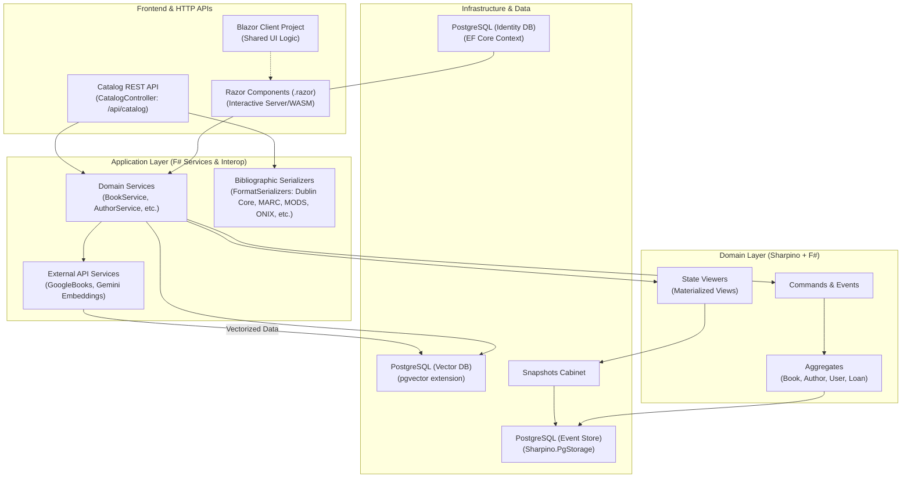

# Architecture Overview: Blazor Book Library

The Blazor Book Library is a modern web application built with a clear separation of concerns, leveraging **Blazor** for a dynamic frontend and **F# with Event Sourcing (Sharpino)** for a robust, traceable backend.

## Architectural Layers

---

## Component Breakdown

### 1. Presentation Layer & Interoperability APIs
- **Interactive Modes**: Supports both `InteractiveServer` (hosting on the server) and `InteractiveWebAssembly` (client-side execution) for optimal user experience.
- **UI Components**: Uses `QuickGrid` for data density and performance, and custom components like `BookSearchToolbar` for complex filtering.
- **Barcode & Vision Integration**: Utilizes JS-interop with `ZXing` for real-time ISBN scanning via device cameras, and camera OCR capture for multi-paper tables of contents and covers.
- **Interactive Geo-Location Mapping**: Utilizes JS-interop with **Leaflet** (`tenantMap.js`) for visual pin-placement of library and user geographical coordinates.
- **Conversational Assistant UI**: Provides the **AI Librarian** interface with multi-turn chat, grounded markdown citations (`book://` protocol), and voice/speech interaction.
- **Catalog Interoperability REST API (`CatalogController`)**: Exposes headless endpoints under `/api/catalog` for external systems and OPAC networks, enabling queries by ISBN, SBN code, or aggregate GUID with format negotiation (`?format=` and `Accept` header) and multi-tenant isolation.

### 2. Application & Domain Layer (F# / Sharpino)
- **CQRS Pattern**: Decouples write operations (Commands) from read operations (Viewers/Queries).
- **Event Sourcing**: Instead of storing the current state, the system stores the **sequence of events** that led to that state. This provides a full audit trail and the ability to rebuild state at any point in time.
- **Sharpino Integration**: A specialized library that handles the heavy lifting of event persistence, aggregate execution, and state caching.
- **Domain Value Objects**: Enforces strict invariants using F# types, including validated `Coordinates` and immutable tenant aggregate state.
- **Bibliographic Serialization Engine (`FormatSerializers`)**: Pure, side-effect-free F# serialization functions transforming domain models into Dublin Core (DCMES 1.1), MARC21/MARCXML, MODS 3.0, ONIX for Books 3.0, BibTeX, Schema.org (JSON-LD), JSON, and CSV.

### 3. Service Layer
- **Domain Services**: Thin wrappers in F# that orchestrate command execution and state retrieval.
- **External Services**: Integrates with the **Google Books API** for metadata lookup and uses **Gemini AI** for synthetic description generation, vision recognition, and high-performance vector embedding creation.
- **AI Librarian RAG Engine**: Orchestrates conversational state with vector similarity retrieval to build grounded context for Gemini, citing specific books and papers.
- **Proximity & Geo-Location Services**: Calculates spherical great-circle distances via the Haversine formula in `TenantService` (`GetAllowedTenantsByProximityAsync`), coupled with client-side coordinate persistence (`UserLocationService`).

### 4. Data Persistence
- **Dual Database Strategy**:
    - **Identity DB**: Uses standard SQL (via EF Core) to manage ASP.NET Identity users, roles, and security tokens.
    - **Event Store**: Uses PostgreSQL to persist JSON-serialized events and snapshots, ensuring high consistency and scalability.
    - **Vector Database**: A specialized PostgreSQL instance powered by the **pgvector** plugin. It handles **vectorized (embedding) information** generated by AI models (e.g., Gemini), enabling high-performance semantic searches through cosine similarity operations (`<=>`). Vectors are partitioned by item type (`book` for overall volume descriptions and `paper` for individual paper abstracts and texts), enabling deep semantic indexing across complex anthologies and proceedings.

### 5. Security & Infrastructure
- **Identity & OAuth**: Integrated with Microsoft Identity and Google OAuth for secure authentication.
- **Bot Protection**: Implements `Recaptcha v3` and a custom `BotScoreService` to mitigate automated abuse.
- **Catalog API Security**: Employs configurable `X-API-Key` authentication for external catalog consumers (`Catalog:ApiKey`), combined with strict multi-tenant boundary checks (public vs. private circuits).
- **Localization**: Full support for `it-IT` and `en-US` via standard .NET localization patterns (`IStringLocalizer`).

### 6. GDPR & Anonymization (Ghosting Pattern)
- **Anonymization Strategy**: To honor GDPR "Right to be Forgotten" while maintaining event stream integrity, the system implements a "Ghosting" pattern.
- **Identity Anonymization**: The ASP.NET Identity record is anonymized (email/username randomized, personal fields cleared) and permanently disabled.
- **Event Integrity**: The underlying F# aggregates (e.g., `User`) remain resolvable by their IDs, ensuring that historical records like loans or reservations don't "break" when a user departs.

### 7. Vector Database Reconciliation
- **Inconsistency Management**: Due to the distributed nature of the Event Store (source of truth) and the Vector Database (materialized view), inconsistencies can arise (e.g., deleted events not propagated, or vector database crashes).
- **Reconciliation Service**: A specialized service provides high-level corrective actions:
    - **Orphan Purging**: Identifies and removes vectors that reference book IDs no longer present in the Event Store.
    - **State Syncing**: Scans the Event Store for books that reference a vector ID, verifies its existence in pgvector, and resets the book's state if the reference is broken.
