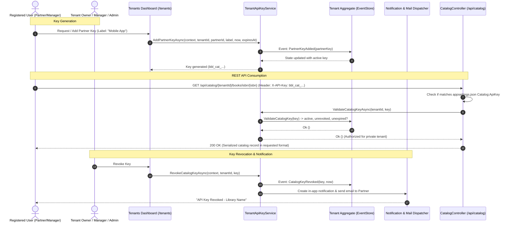
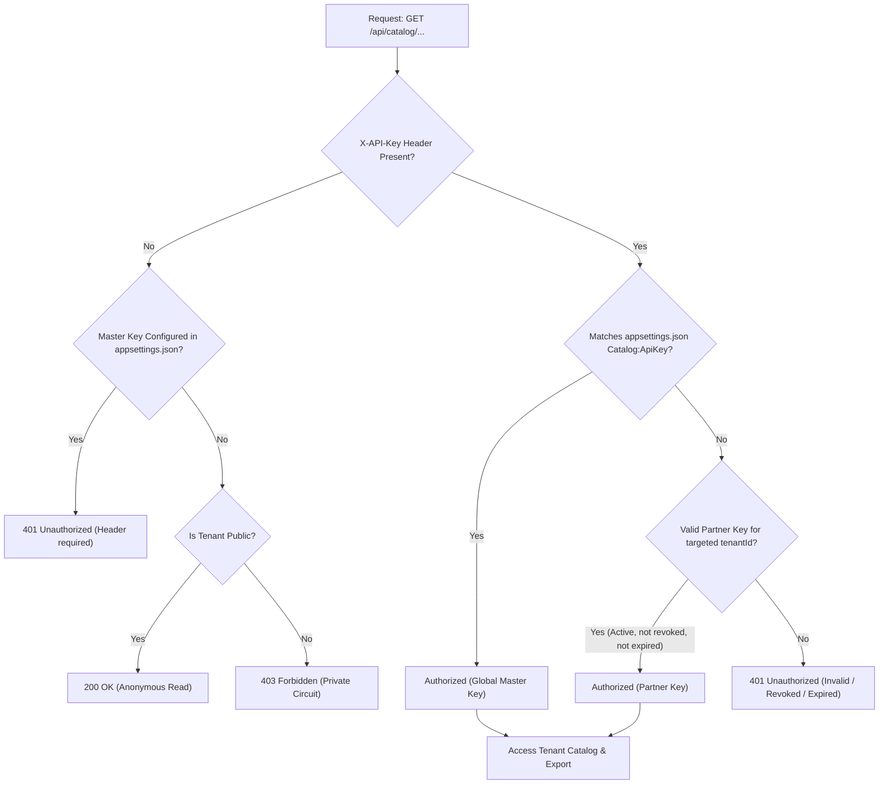

# Tenant & Partner API Keys Architecture & Specification

## 1. Overview & Dual-Tier Model

The Blazor Book Library provides a dual-tier API key authentication system for external catalog consumers, university networks, mobile apps, and automated harvesters:

1. **Global Master API Key (`Catalog:ApiKey`)**:
   - Configured centrally in `appsettings.json` under `"Catalog": { "ApiKey": "YOUR_GLOBAL_KEY" }`.
   - Administered at the platform infrastructure level.
   - Authorizes requests across **all circuits/tenants**, including the Default Sandbox (`TenantId.Default`) and private tenants.
2. **Per-Tenant Partner API Keys (`bbl_cat_<uniqueId>`)**:
   - Issued dynamically per tenant circuit.
   - Bound to a specific registered developer/partner user (`PartnerId: UserId`).
   - Stored and tracked as part of the immutable event-sourced `Tenant` aggregate state.
   - Authorizes access strictly to that specific tenant circuit (including private tenants). Attempting to use a partner key on a different tenant circuit is rejected.

---

## 2. Partner Key Format & Structure

Partner keys are strongly typed value objects in the domain commons:

- **Type**: `CatalogApiKey`
- **Format**: `bbl_cat_<32-hex-guid>` (e.g. `bbl_cat_a1b2c3d4e5f67890123456789abcdef0`)
- **Factory**: `CatalogApiKey.New()` or `CatalogApiKey.New(guid)`
- **Validation**: `CatalogApiKey.IsValid(str)` and `CatalogApiKey.FromString(str)`

### Partner Key Data Model (`PartnerApiKey`)

```fsharp
type PartnerApiKey =
    { Key: CatalogApiKey
      PartnerId: UserId
      Label: string
      CreatedAt: DateTime
      RevokedAt: DateTime option
      ExpiresAt: DateTime option }
```

| Field | Description |
| :--- | :--- |
| `Key` | The unique `bbl_cat_...` key string. |
| `PartnerId` | The registered user ID of the partner/developer. |
| `Label` | Human-readable descriptor (e.g., "Mobile OPAC App", "University Harvester"). |
| `CreatedAt` | UTC timestamp of key creation. |
| `RevokedAt` | Optional UTC timestamp of key revocation. |
| `ExpiresAt` | Optional UTC timestamp after which the key becomes inactive. |

---

## 3. Sequence Diagram: Key Lifecycle & REST Call



---

## 4. Key Management & Permissions

- **Tenant Owners & Managers**:
  - Can view their own key and existing partner keys associated with their tenant in `/tenants` and `TenantDetails.razor`.
  - Can generate a partner key for themselves or for registered partner users.
  - Can revoke partner keys when no longer needed.
- **Global Administrators**:
  - Have oversight across all tenants.
  - Can inspect, revoke, or delete partner keys on any tenant.
- **Revocation Notifications**:
  - When a manager or partner's key is revoked, `TenantApiKeyService` automatically:
    1. Creates an **in-app notification** via `INotificationService` with a direct link to `/tenants`.
    2. Sends an **email alert** via `IMailNotificator` containing the key details and security advisory.

---

## 5. Catalog REST API Integration

The `CatalogController` (`/api/catalog`) evaluates incoming requests as follows:



### Supported Routes

| Route | Description |
| :--- | :--- |
| `GET /api/catalog/books/isbn/{isbn}` | Query by ISBN on Default Tenant (uses Master Key or anonymous if unconfigured) |
| `GET /api/catalog/{tenantId}/books/isbn/{isbn}` | Query by ISBN on specific Tenant (accepts Master Key or Tenant Partner Key) |
| `GET /api/catalog/{tenantId}/books/sbn/{sbn}` | Query by national SBN code on specific Tenant |
| `GET /api/catalog/{tenantId}/books/id/{id}` | Query by Book ID GUID on specific Tenant |
| `GET /api/catalog/{tenantId}/books` | Bulk export full catalog for specific Tenant |

All endpoints support format negotiation via `?format=` query parameter or HTTP `Accept` header (e.g. `marcxml`, `mods`, `onix`, `dublincore`, `bibtex`, `schemaorg`, `json`, `csv`).